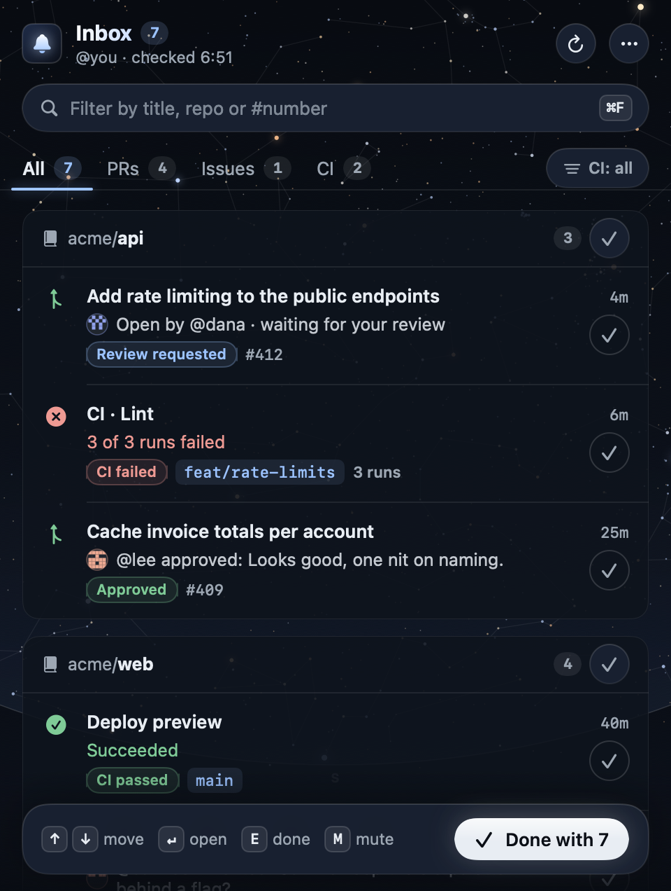
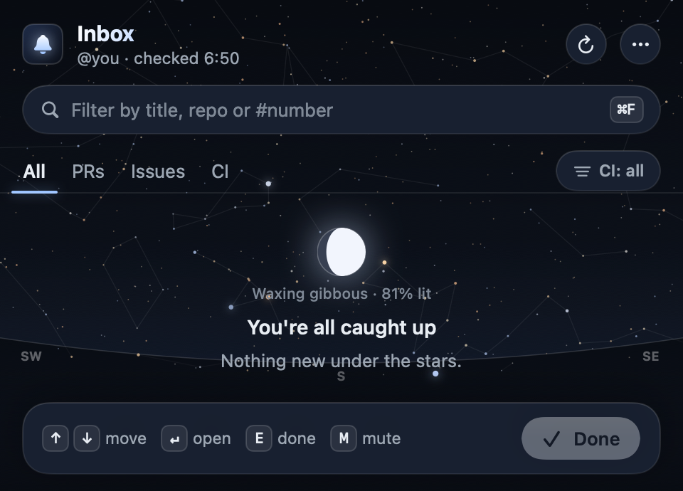
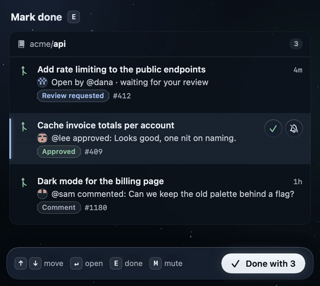

# Belfry

A small native macOS menu-bar app that rings when something happens on GitHub. It has a quiet night-sky look
of its own: a faint starfield, one ice-blue accent, GitHub's state colours muted so they inform rather than shout,
macOS Liquid Glass on the controls that float, and small animations for every action. Behind it all is the
real night sky over you, right now: about 5,000 catalogued stars in their true colours, faint constellation
lines and the Moon in its current phase, placed for your location and the current time, looking up toward the
south. Location comes from your Mac's time zone (no permission needed) or, if you turn it on, Location
Services; it never leaves your Mac. A daylight variant that follows Light Mode is in Settings › Sky. All of it stays still
when Reduce Motion is on.

<p align="center"></p>

<p align="center"></p>

<p align="center"></p>

- **Banners that say what happened.** "@sam approved: looks good", "@kim commented: …", "Merged by @lee",
  "✗ 3 of 3 runs failed · CI, Lint". Clicking a banner opens the exact PR, review or comment.
- **An inbox in the menu bar**, grouped by repository, with tabs for All, PRs, Issues and CI. PRs have
  sub-tabs: Review (every open PR waiting on you, from `review-requested:@me`), Comments, Approved, Changes
  and Merged/Closed.
- **Triage like mail.** Use ↑↓ to move, ↵ to open, E to mark done and M to mute the thread, or ⌘F to filter.
  Right-click a row for more. "Done with N" clears what you're looking at, and every Done or Mute waits six
  seconds so you can undo it (⌘Z).
- **CI without the noise.** Runs collapse into one row per repo and branch. Choose all runs, failures only or
  none; the choice applies to the list, the count and the banners.
- **Careful with your attention and data.** Belfry announces each piece of activity once, asks for notification
  permission only after the first successful check, polls with `If-Modified-Since` and respects GitHub's
  `X-Poll-Interval`. The token stays in the Keychain, and Belfry talks only to api.github.com.

Requires macOS 14 or later. Written in Swift and SwiftUI with no third-party
dependencies.

## Build and run

You need Xcode and [XcodeGen](https://github.com/yonaskolb/XcodeGen)
(`brew install xcodegen`).

```bash
make run        # generate the project, build Release, launch
```

Or step by step:

```bash
xcodegen generate
xcodebuild -project Belfry.xcodeproj -scheme Belfry -configuration Release -derivedDataPath build build
open build/Build/Products/Release/Belfry.app
```

To install, copy `build/Build/Products/Release/Belfry.app` into
`/Applications` (`make install`). Launch at login works best from there.

On first launch macOS asks whether Belfry may send notifications. Choose
**Allow**. Under System Settings → Notifications → Belfry, set the alert
style to **Banners** (or **Alerts** if you want them to stay until dismissed).

If you clicked "Don't Allow", macOS drops every banner silently. Belfry shows
an orange "macOS is blocking Belfry's banners" strip with a button that opens
the right settings page.

On first launch with an empty history, Belfry only shows banners for activity
from the last 24 hours and quietly marks everything older as seen.

## Creating the token

1. Open <https://github.com/settings/tokens/new?scopes=notifications,repo&description=Belfry>
   (Settings → Developer settings → Personal access tokens → Tokens (classic)).
2. Keep the `notifications` and `repo` scopes. `repo` is needed to resolve
   private pull requests and issues to their web URLs. Pick an expiry.
3. Generate the token, open the Belfry menu, paste it and click **Connect**. Belfry checks it with GitHub
   before saving it.

The token is stored only in your login Keychain, under the service
`io.github.baramir.belfry`. It never touches the repository or a config file.

For development you can skip the Keychain by setting `BELFRY_GITHUB_TOKEN` in
the environment when you run the binary directly:

```bash
BELFRY_GITHUB_TOKEN="$(gh auth token)" build/Build/Products/Release/Belfry.app/Contents/MacOS/Belfry
```

To see what Belfry resolves for your current notifications without the UI:

```bash
BELFRY_GITHUB_TOKEN="$(gh auth token)" build/Build/Products/Release/Belfry.app/Contents/MacOS/Belfry --dump
```

To render every screen and state to PNGs from fictional data (for design review), or every action animation
frame by frame (30 fps, one folder per action, ready for `ffmpeg`):

```bash
build/Build/Products/Release/Belfry.app/Contents/MacOS/Belfry --snapshot /tmp/belfry-snapshots
build/Build/Products/Release/Belfry.app/Contents/MacOS/Belfry --animations /tmp/belfry-frames
```

See [docs/research.md](docs/research.md) for how Belfry compares with other clients and what's next.

## A note on your own activity

GitHub doesn't notify you about your own actions. If scripts, bots or agents
push and comment using your account, Belfry won't ring for that activity,
because GitHub never creates the notification.

## Layout

```
project.yml                 XcodeGen spec (the .xcodeproj is generated, not committed)
Belfry/Sources/
  BelfryApp.swift           MenuBarExtra + Settings scenes
  AppDelegate.swift         notification permission, banner click → open URL
  NotificationStore.swift   polling, inbox items, banners, Done/Mute with undo, keyboard selection
  Theme.swift               colour tokens, spacing scale, button and chip styles
  TokenEntryView.swift      first-run setup and token repair inside the panel
  Snapshot.swift            --snapshot renderer and fixtures
  GitHubClient.swift        REST calls, Last-Modified/Link handling, html URL resolution
  MenuContentView.swift     the panel: header, search, tabs, rows, footer
  SettingsView.swift        token, interval, sound, launch at login
  Keychain.swift            token storage
scripts/make-icon.swift     draws the app icon into the asset catalog
```

## License

MIT. The star catalog comes from d3-celestial (BSD-3-Clause); see [THIRD-PARTY-NOTICES.md](THIRD-PARTY-NOTICES.md).
